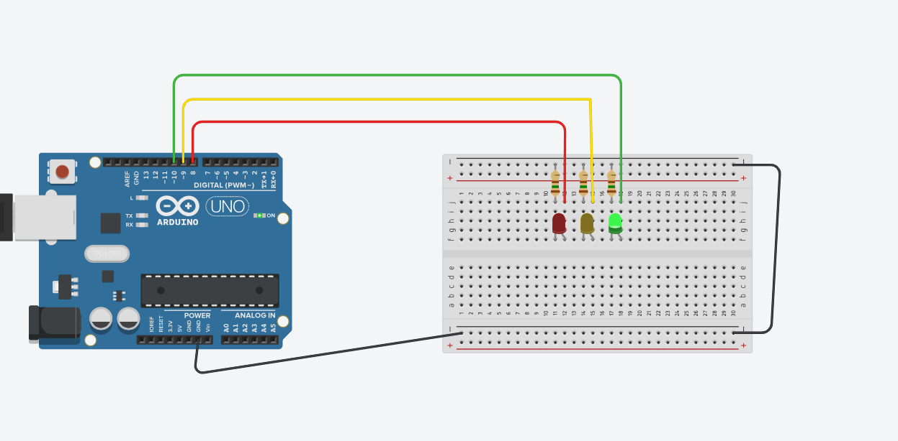
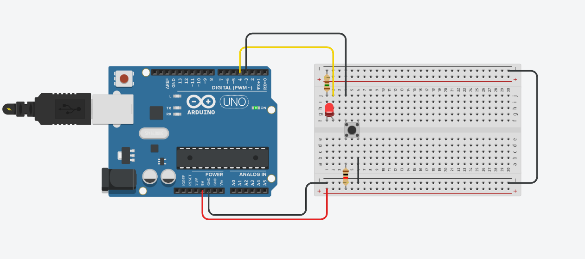
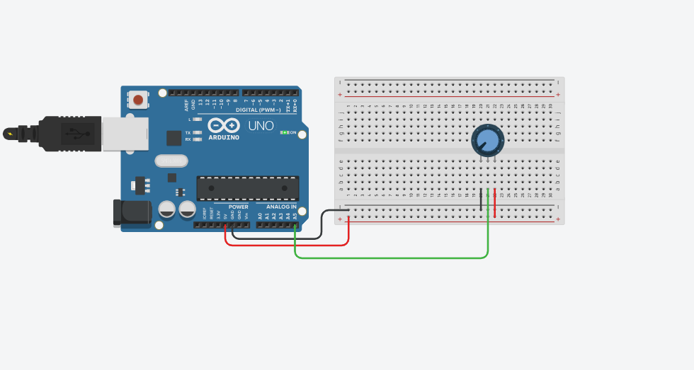

# Estudos de Arduino

Os exercícios que fiz quando estava aprendendo eletrônica e Arduino. Foi daqui que saiu a base para o SIF, o sistema de irrigação que depois foi premiado na Ficiências.

Cada pasta é um passo, do LED piscando até organizar o código em classes de C++. Os circuitos foram montados no Tinkercad.

Um tempo depois voltei aqui para uma revisão: o código continua o que eu escrevi na época, só corrigi o que não funcionava (a lista está no fim).

| Pasta | O que treina |
|---|---|
| [`01_luzinha`](01_luzinha) | piscar o LED da própria placa |
| [`02_luzinha_externa`](02_luzinha_externa) | LED ligado numa porta digital |
| [`03_semaforo`](03_semaforo) | sequência de LEDs com tempo |
| [`04_porta_analogica`](04_porta_analogica) | PWM: o LED acende e apaga aos poucos |
| [`05_botao_liga_desliga`](05_botao_liga_desliga) | botão que liga e desliga o LED |
| [`06_pull_down_up`](06_pull_down_up) | resistores de pull-down e pull-up |
| [`07_luz_rgb`](07_luz_rgb) | LED RGB trocando de cor pelo botão |
| [`08_classes_rgb`](08_classes_rgb) | o mesmo LED RGB, agora organizado em classes |
| [`09_entrada_analogica_serial`](09_entrada_analogica_serial) | leitura de um potenciômetro enviada pela serial |

## Os circuitos

### 03 · Semáforo

### 04 · Porta analógica

### 05 · Botão liga e desliga

### 06 · Pull-down e pull-up

### 07 · LED RGB

### 08 · LED RGB com classes

### 09 · Entrada analógica pela serial

## Como usar

Abra o `.ino` de qualquer pasta na Arduino IDE e envie para a placa. Ou monte o circuito no Tinkercad e cole o código lá.

## O que foi corrigido na revisão

- **01:** estava escrito `daley` no lugar de `delay`, então nem compilava.
- **03:** o amarelo e o verde acendiam o LED trocado. Agora o código usa os nomes de cada cor (`led_Vermelho`, `led_Amarelo`, `led_Verde`) e a ordem é vermelho, verde, amarelo.
- **04:** o segundo `for` nunca rodava (`i < min` com `i--`), então o LED só acendia e não apagava. E o máximo era 16, quando o PWM vai até 255.
- **05:** na época o nome da pasta era "botao on off que nao fungaaaa". O motivo: eu usei `==`, que compara, no lugar de `=`, que atribui. As variáveis do botão nunca mudavam.
