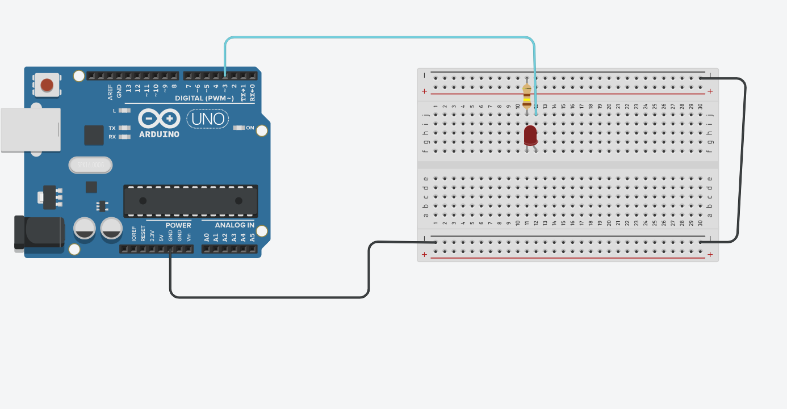
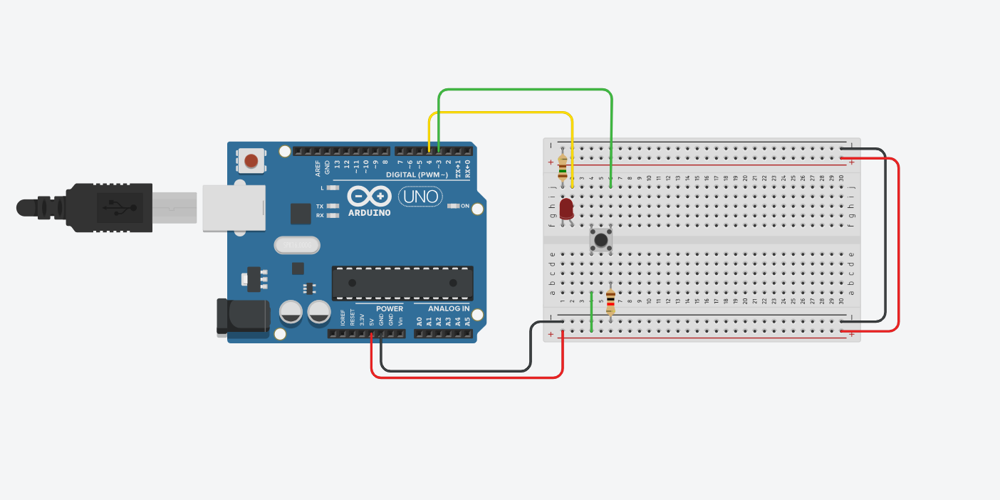
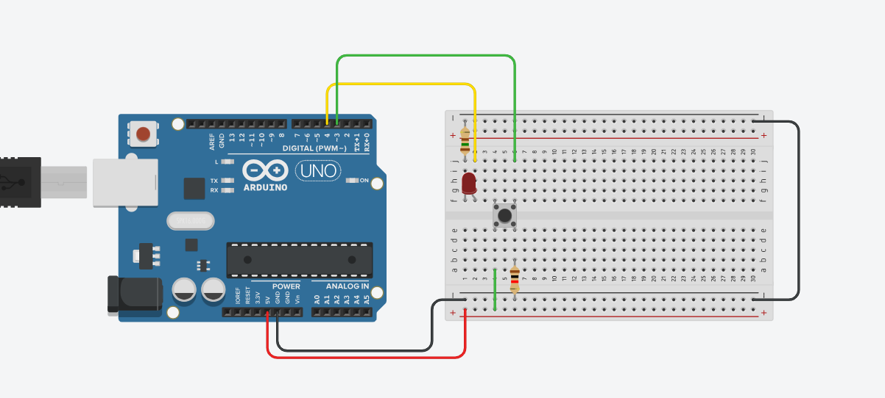
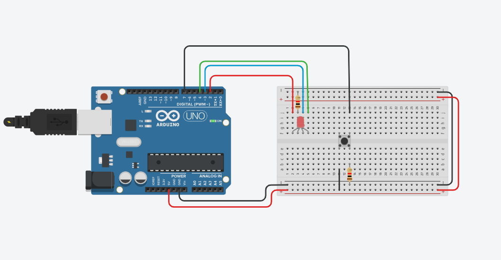
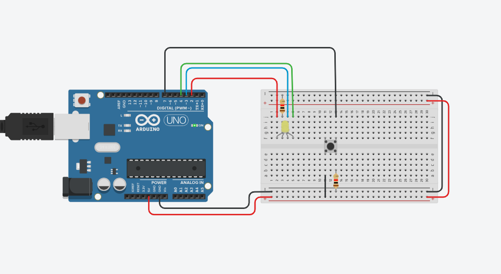
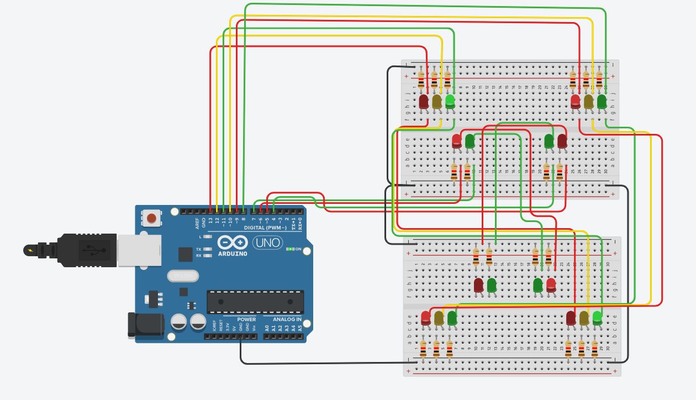

# Estudos de Arduino

Os exercícios que fiz quando estava aprendendo eletrônica e Arduino. Foi daqui que saiu a base para o SIF, o sistema de irrigação que depois foi premiado na Ficiências.

Cada pasta é um passo: do LED piscando até classes em C++ e, depois, o ESP32 com Wi-Fi. Os circuitos foram montados no Tinkercad.

Um tempo depois voltei aqui para uma revisão: o código continua o que eu escrevi na época, só corrigi o que não funcionava.

| Pasta | O que treina |
|---|---|
| [`01_luzinha`](01_luzinha) | piscar o LED da própria placa |
| [`02_luzinha_externa`](02_luzinha_externa) | LED ligado numa porta digital |
| [`03_semaforo`](03_semaforo) | sequência de LEDs com tempo |
| [`04_porta_analogica`](04_porta_analogica) | PWM: o LED acende e apaga aos poucos |
| [`05_botao_liga_desliga`](05_botao_liga_desliga) | botão que liga e desliga o LED |
| [`06_pull_down_up`](06_pull_down_up) | resistores de pull-down e pull-up |
| [`07_luz_rgb`](07_luz_rgb) | LED RGB trocando de cor pelo botão |
| [`08_classes_rgb`](08_classes_rgb) | o mesmo LED RGB, agora organizado em classes |
| [`09_entrada_analogica_serial`](09_entrada_analogica_serial) | leitura de um potenciômetro enviada pela serial |

Depois disso passei para o ESP32, que já vem com Wi-Fi. Foi nessa fase que o projeto de irrigação começou a tomar forma:

| Pasta | O que treina |
|---|---|
| [`10_rele`](10_rele) | relé ligando e desligando uma bomba d'água a cada 10 segundos |
| [`11_umidade_liga_bomba`](11_umidade_liga_bomba) | sensor de umidade do solo decidindo quando ligar a bomba |
| [`12_wifi_servidor`](12_wifi_servidor) | conectar no Wi-Fi e responder numa rota HTTP |
| [`13_relogio_ntp`](13_relogio_ntp) | relógio: busca a hora certa na internet (NTP) e mostra data, hora e dia da semana |
| [`14_semaforo_cruzamento`](14_semaforo_cruzamento) | de volta ao Arduino: cruzamento com dois semáforos e sinal de pedestre que pisca antes de fechar |

## Os circuitos

### 03 · Semáforo

### 04 · Porta analógica

### 05 · Botão liga e desliga

### 06 · Pull-down e pull-up

### 07 · LED RGB

### 08 · LED RGB com classes

### 09 · Entrada analógica pela serial

### 14 · Semáforo de cruzamento

## Como usar

Abra o `.ino` de qualquer pasta na Arduino IDE e envie para a placa. Ou monte o circuito no Tinkercad e cole o código lá.

Do `10` ao `13` a placa é um ESP32. Para os de Wi-Fi (`12` e `13`), troque `NOME_DA_REDE` e `SENHA_DA_REDE` pelos dados da sua rede. As bibliotecas usadas são instaladas pelo gerenciador da IDE:

- `12`: ESPAsyncWebServer
- `13`: NTPClient, Time e Timezone
